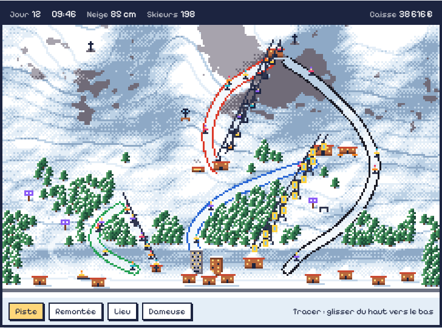

# Tire-Fesses

Un jeu web en pixel art : on construit et on gère une petite station de ski.
On trace les pistes, on pose les remontées (téléski, télésiège, télécabine),
on ouvre des restaurants, des cafés, des points de vue et des activités.
Jouable dans le navigateur.

## Où en est le projet

Le jeu n'existe pas encore : on fixe d'abord son apparence et ses règles.

- [x] Le nom
- [x] La charte graphique : [`docs/CHARTE.md`](docs/CHARTE.md)
- [ ] La doc « Comment jouer »
- [ ] Le développement

## Licence

Code et documents sous licence [MIT](LICENSE). La police Pixelify Sans est
sous licence SIL Open Font License.
