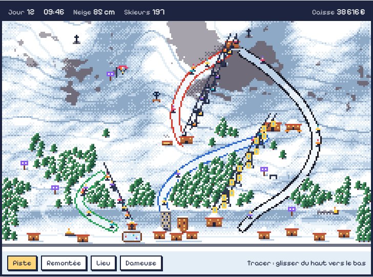
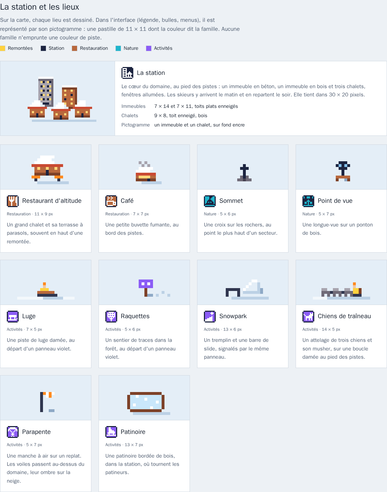

# Charte graphique de Tire-Fesses

Ce document fixe l'apparence du jeu avant la première ligne de code. Tout ce
qui sera dessiné ensuite (terrain, remontées, lieux, interface) doit pouvoir
se poser sur la station d'essai ci-dessous sans détonner.

La planche de référence est [`charte/planche.html`](charte/planche.html) :
ouverte dans un navigateur, elle montre la station d'essai animée, chaque
dessin à la loupe, la palette et la police. Les images de ce document en sont
des captures.

Le décor de la planche est généré pour juger l'ensemble. Les dessins
définitifs viendront ensuite, dans ces règles.

## Les trois choix

| | Choix | Pourquoi |
|---|---|---|
| Point de vue | **Vue de dessus** | Tracer une piste à la souris ou au doigt est simple et précis, tout le domaine se voit d'un coup, et chaque objet n'a qu'un dessin. |
| Palette | **Grand beau** | Les quatre couleurs de piste ressortent le mieux sur la neige, et elle reste reposante pendant des heures. |
| Police | **Pixelify Sans** | Une police pixel avec de vraies minuscules et tous les accents, lisible même en phrases. |

Écartés lors du choix : le plan des pistes en perspective (ce qui est derrière
une crête disparaît), l'isométrique (deux fois plus de dessins), les palettes
« Affiche 70 » et « Heure bleue », les polices Silkscreen et Press Start 2P.

## Le point de vue

Le terrain est vu d'en haut ; les objets sont vus de face. Un sapin, un
chalet, un pylône se lisent debout, posés sur la carte, comme dans les jeux
16 bits. Le relief se lit par l'ombrage de la neige et par les courbes de
niveau, régulières, une sur quatre plus marquée.

## La palette « Grand beau »

32 couleurs. Une couleur absente de cette liste n'entre pas dans le jeu.

| Identifiant | Nom | Couleur |
|---|---|---|
| `neige-0` | Neige au soleil | `#ffffff` |
| `neige-1` | Neige | `#e4eef7` |
| `neige-2` | Neige à l'ombre | `#bcd1e5` |
| `neige-3` | Ombre profonde | `#8ea9c6` |
| `neige-damee` | Neige damée | `#f3f8fc` |
| `roche-0` | Roche claire | `#a7a3ad` |
| `roche-1` | Roche | `#706b78` |
| `roche-2` | Roche sombre | `#464150` |
| `sapin-0` | Sapin clair | `#4f9c62` |
| `sapin-1` | Sapin | `#2f714b` |
| `sapin-2` | Sapin sombre | `#1d4a37` |
| `tronc` | Tronc | `#5b3a2b` |
| `bois-0` | Bois · restauration | `#b8683d` |
| `bois-1` | Bois sombre | `#7d4128` |
| `toit` | Toit | `#c94a32` |
| `ciel-0` | Ciel haut | `#4fa3e3` |
| `ciel-1` | Ciel · vitres | `#86c4f0` |
| `ciel-2` | Ciel à l'horizon | `#c9e7fb` |
| `encre` | Encre · station | `#1c2440` |
| `cable` | Câble | `#30364f` |
| `piste-verte` | Piste verte | `#23a052` |
| `piste-bleue` | Piste bleue | `#2a67d4` |
| `piste-rouge` | Piste rouge | `#dc3a2a` |
| `piste-noire` | Piste noire | `#1a1a24` |
| `peau` | Peau | `#f2c5a0` |
| `orange-balise` | Orange balise · alertes | `#ff8a1f` |
| `jaune-remontee` | Jaune · remontées | `#ffd23f` |
| `framboise` | Framboise | `#e83f6f` |
| `cyan` | Cyan · nature | `#1fb5cc` |
| `violet` | Violet · activités | `#8b5cf6` |
| `lumiere` | Lumière | `#ffd77a` |
| `route` | Route | `#6e7383` |

Les mêmes couleurs, dans le même ordre, en fichiers :
[`grand-beau.gpl`](../assets/palette/grand-beau.gpl) (Aseprite, GIMP),
[`grand-beau.hex`](../assets/palette/grand-beau.hex) (Lospec) et
[`grand-beau.png`](../assets/palette/grand-beau.png) (8 × 4 cases de 16 px).

### Les couleurs qui veulent dire quelque chose

| Couleur | Sens | Où |
|---|---|---|
| `piste-verte`, `piste-bleue`, `piste-rouge`, `piste-noire` | Difficulté d'une piste | Les pistes, **et rien d'autre** |
| `orange-balise` | Alerte | Messages et signaux de l'interface |
| `jaune-remontee` | Remontées | Pastilles des remontées, cabines de la télécabine |
| `encre` | Station | Pastille de la station |
| `bois-0` | Restauration | Pastilles du restaurant et du café |
| `cyan` | Nature | Pastilles des sommets et des points de vue |
| `violet` | Activités | Pastilles et panneaux des activités |

Aucune famille de lieux n'emprunte une couleur de piste.

## La police

Pixelify Sans, sous licence SIL Open Font License : elle sera livrée avec le
jeu. L'interface s'affiche à la taille de l'écran ; elle n'est pas agrandie
avec la carte.

| | |
|---|---|
| Titres | 24 px, gras (700) |
| Texte | 16 px, normal (400) |
| Tailles | ces deux-là seulement |
| Chiffres | alignés en colonne (`tabular-nums`) |
| Casse | casse de phrase ; tout en capitales seulement pour le logo |

## Les tailles

Une case fait 8 × 8 pixels. L'écran agrandit toujours par un nombre entier
(×2, ×3, ×4), jamais avec du lissage. L'ancre de chaque dessin est son pixel
du bas, au milieu : c'est le point où l'objet touche la neige.

| Dessin | Taille (px) |
|---|---|
| Skieur | 3 × 5 |
| Sapin | 5 × 7 |
| Chalet | 9 × 8 |
| Immeuble béton / bois | 7 × 14 / 7 × 11 |
| Station (composée) | 30 × 20 |
| Pylône téléski / télésiège / télécabine | 3 × 7 / 5 × 9 / 5 × 11 |
| Gare téléski / télésiège / télécabine | 7 × 6 / 10 × 8 / 12 × 10 |
| Siège / cabine | 3 × 3 / 3 × 4, sous une attache |
| Restaurant d'altitude | 11 × 9 |
| Café | 7 × 7 |
| Croix de sommet | 5 × 6 |
| Longue-vue | 5 × 7 |
| Luge / panneau d'activité / snowpark | 7 × 5 / 5 × 6 / 13 × 6 |
| Attelage de chiens / manche à air / patinoire | 14 × 5 / 5 × 7 / 13 × 7 |
| Parapente en vol | 7 × 6 |
| Pictogramme | 11 × 11 |

## Les remontées

Le pylône suffit à reconnaître le type, même quand aucun véhicule ne passe.

| | Téléski (tire-fesses) | Télésiège | Télécabine |
|---|---|---|---|
| Pylône | 7 px, petite traverse | 9 px, large traverse | 11 px, en treillis |
| Câbles | un | deux : montée et descente | deux : montée et descente |
| Véhicule | perche à assiette, skieur debout au sol | siège ouvert couleur encre, skieur assis | cabine jaune à fenêtre |
| Gare | une cabane, en bas seulement | bâtiment moyen, en bas et en haut | grand bâtiment, en bas et en haut |
| Au sol | une trace damée sous la ligne | rien | rien |

## La station et les lieux

Sur la carte, chaque lieu est dessiné. Dans l'interface (légende, bulles,
menus), il est représenté par son **pictogramme** : une pastille de 11 × 11,
coins coupés, bordée d'encre, remplie de la couleur de sa famille, symbole en
encre ou en blanc selon le contraste.

| Lieu | Famille | Sur la carte |
|---|---|---|
| Station | Station | Un immeuble en béton, un immeuble en bois, trois chalets, fenêtres allumées, au pied des pistes |
| Restaurant d'altitude | Restauration | Un grand chalet et sa terrasse à parasols |
| Café | Restauration | Une petite buvette fumante au bord des pistes |
| Sommet | Nature | Une croix sur les rochers |
| Point de vue | Nature | Une longue-vue sur un ponton de bois |
| Luge | Activités | Une piste de luge damée, une luge, un panneau violet |
| Raquettes | Activités | Un sentier de traces dans la forêt, un panneau violet |
| Snowpark | Activités | Un tremplin et une barre de slide, un panneau violet |
| Chiens de traîneau | Activités | Un attelage de trois chiens et son musher sur une boucle damée, un panneau violet |
| Parapente | Activités | Une manche à air sur un replat, un panneau violet ; les voiles passent au-dessus du domaine, leur ombre sur la neige |
| Patinoire | Activités | Une patinoire bordée de bois, dans la station, où tournent les patineurs |

Les remontées ont aussi leur pictogramme (famille jaune) : une perche, un
siège, une cabine.

## Les pistes

Les couleurs suivent la norme française : verte (très facile), bleue
(facile), rouge (difficile), noire (très difficile). Une piste est une bande
de neige damée de 5 px bordée de sa couleur. Pour les joueurs daltoniens,
chaque couleur a aussi son pictogramme de 7 × 7 : rond (verte), carré
(bleue), triangle (rouge), losange (noire).

## Les règles de dessin

- **La lumière** vient du haut à gauche. Les ombres tombent en bas à droite,
  sur les versants comme au pied des objets (deux pixels d'ombre sous un
  sapin, une bande sous un bâtiment).
- **Les contours** : pas de trait noir autour des objets. Chaque objet est
  bordé par la plus sombre de ses propres teintes. Seuls les pictogrammes et
  les cadres de l'interface ont un bord d'encre.
- **La neige** : quatre teintes, du plein soleil à l'ombre, mêlées par une
  trame de points (matrice de Bayer 4 × 4) plutôt que par un dégradé.
- **Le mouvement** : 4 à 6 images par animation, 8 à 12 images par seconde.
  Un objet avance d'un pixel entier, jamais d'un demi.
- **L'interface** : cadres et boutons dessinés en pixels, dans les couleurs de
  la palette, ombre portée pleine de 2 px.
- **Les noms** : pistes, remontées et lieux portent des noms de montagne
  (Combe du Loup, Télécabine du Plateau, Café des Marmottes).

## Reste à faire

- Le logo, l'icône du jeu et la mascotte.
- Les dessins définitifs, dans ces règles, à partir de la palette en fichier.
