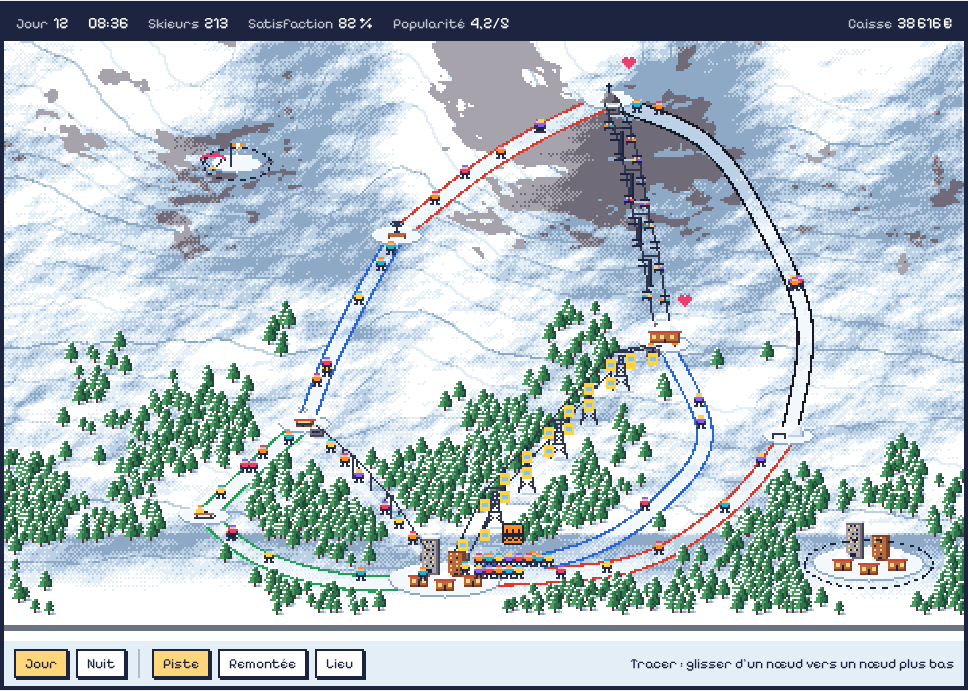
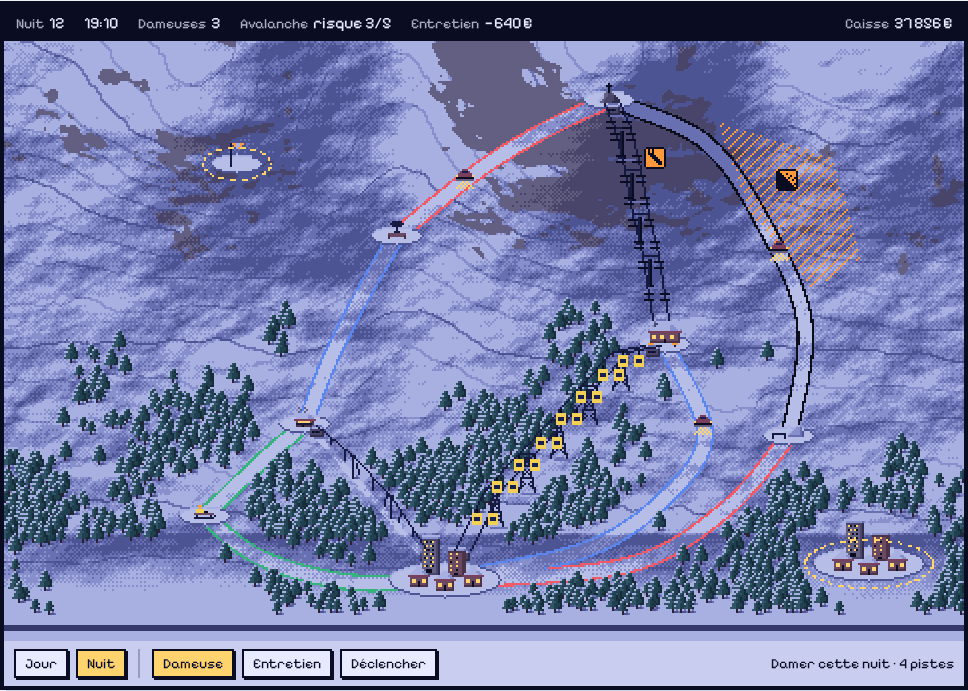
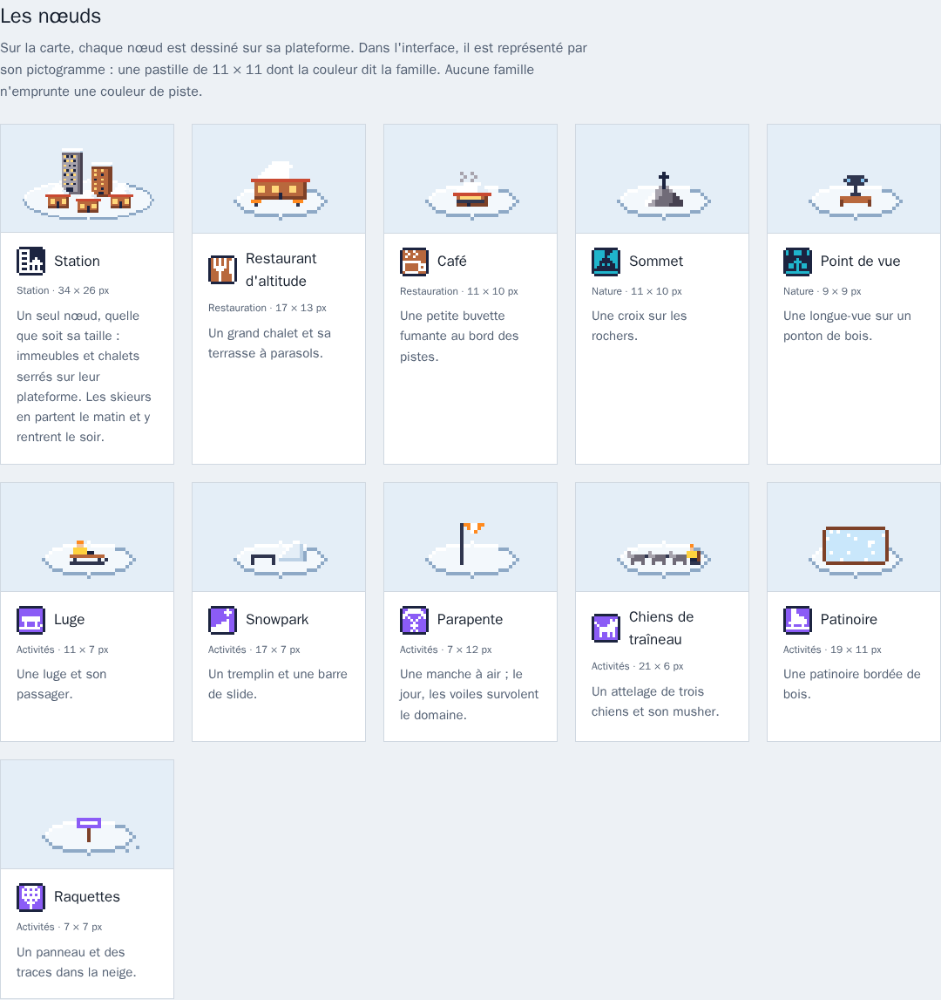
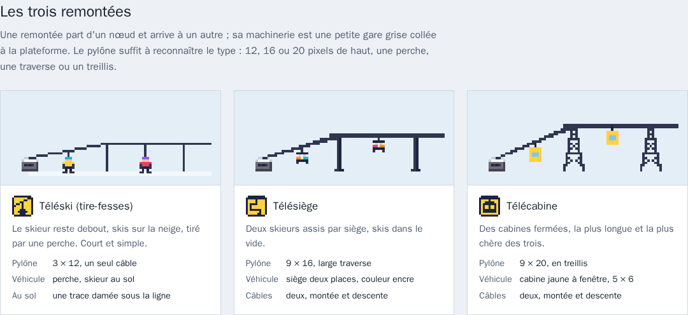

# Charte graphique de Tire-Fesses

Ce document fixe l'apparence du jeu avant la première ligne de code. Tout ce
qui sera dessiné ensuite doit pouvoir se poser sur le domaine d'essai
ci-dessous sans détonner.

La planche de référence est [`charte/planche.html`](charte/planche.html) :
ouverte dans un navigateur, elle montre le domaine d'essai animé, de jour et de
nuit, chaque dessin à la loupe, les deux palettes et la police. Les images de
ce document en sont des captures.

Le décor de la planche est généré pour juger l'ensemble. Les dessins
définitifs viendront ensuite, dans ces règles.

## Les choix

| | Choix | Pourquoi |
|---|---|---|
| Point de vue | **Vue de dessus** | Tracer une piste à la souris ou au doigt est simple et précis, tout le domaine se voit d'un coup, et chaque objet n'a qu'un dessin. |
| Résolution | **Case de 16 × 16**, carte de base de 480 × 300 px, agrandie ×2 | Assez de pixels pour qu'un chalet ait des fenêtres et un sapin de la neige sur ses branches. |
| Palette | **Grand beau** le jour, sa **jumelle de nuit** la nuit | Les quatre couleurs de piste ressortent sur la neige ; la nuit garde les mêmes dessins. |
| Police | **Pixelify Sans** | Une police pixel avec de vraies minuscules et tous les accents, lisible même en phrases. |

## Un jeu de nœuds et de flux

Un domaine skiable est un graphe. Le dessin doit le rendre lisible au premier
regard.

- **Un nœud, un point.** Une station est un seul nœud, quelle que soit sa
  taille. Un lieu aussi. Chaque nœud est posé sur une **plateforme** de neige
  damée, une ellipse claire au bord ombré en bas à droite : c'est là qu'on
  accroche les liens.
- **Deux sortes de liens.** Les remontées montent d'un nœud à un autre ; les
  pistes descendent, en couleur de difficulté. Rien ne se pose au milieu de
  nulle part.
- **Plusieurs stations.** Un domaine peut relier plusieurs stations. Un nœud
  entouré de **pointillés** qui tournent n'est pas encore relié au réseau.
- **Des cartes qui grandissent.** La carte de base tient sur un écran (30 × 19
  cases). Les suivantes sont plus étendues, défilent, et comptent plus de
  stations à relier.

## Les nœuds

Sur la carte, chaque nœud est dessiné sur sa plateforme. Dans l'interface
(légende, bulles, menus), il est représenté par son **pictogramme** : une
pastille de 11 × 11, coins coupés, bordée d'encre, remplie de la couleur de sa
famille, symbole en encre ou en blanc selon le contraste.

| Nœud | Famille | Sur la carte | Taille (px) |
|---|---|---|---|
| Station | Station | Un immeuble en béton, un immeuble en bois et trois chalets serrés, fenêtres allumées | 34 × 26 |
| Restaurant d'altitude | Restauration | Un grand chalet et sa terrasse à parasols | 17 × 13 |
| Café | Restauration | Une petite buvette fumante | 11 × 10 |
| Sommet | Nature | Une croix sur les rochers | 11 × 10 |
| Point de vue | Nature | Une longue-vue sur un ponton de bois | 9 × 9 |
| Luge | Activités | Une luge et son passager | 11 × 7 |
| Snowpark | Activités | Un tremplin et une barre de slide | 17 × 7 |
| Parapente | Activités | Une manche à air ; le jour, des voiles survolent le domaine avec leur ombre | 7 × 12 |
| Chiens de traîneau | Activités | Un attelage de trois chiens et son musher | 21 × 6 |
| Patinoire | Activités | Une patinoire bordée de bois | 19 × 11 |
| Raquettes | Activités | Un panneau et des traces dans la neige | 7 × 7 |

Plateformes : 56 × 18 pour une station, 26 × 10 pour un lieu.

## Les remontées

Une remontée part d'un nœud et arrive à un autre. Sa machinerie est une petite
**gare grise** (7 × 6) collée à la plateforme, de part et d'autre. Le pylône
suffit à reconnaître le type, même quand aucun véhicule ne passe.

| | Téléski (tire-fesses) | Télésiège | Télécabine |
|---|---|---|---|
| Pylône | 3 × 12, petite traverse | 9 × 16, large traverse | 9 × 20, en treillis |
| Câbles | un | deux : montée et descente | deux : montée et descente |
| Véhicule | perche, skieur debout au sol | siège deux places couleur encre | cabine jaune à fenêtre, 5 × 6 |
| Au sol | une trace damée sous la ligne | rien | rien |

## Le jour et la nuit

Le jeu se joue en deux phases, et le dessin les distingue sans rien redessiner.

- **Le jour**, on regarde les flux : les skieurs descendent les pistes et
  montent les remontées, une file se forme au pied d'une remontée trop
  chargée, des cœurs montent au-dessus des lieux qui plaisent. L'interface
  affiche la satisfaction, la popularité et la caisse.
- **La nuit**, on regarde les coûts : les remontées s'arrêtent, les dameuses
  passent phares allumés, les pentes à risque d'avalanche sont hachurées
  d'orange, une remontée à réviser porte la pastille d'entretien. L'interface
  affiche les dameuses, le risque, l'entretien et la caisse.

La nuit ne change pas les dessins, elle change la palette : **chaque couleur a
sa jumelle de nuit**, au même rang. Seuls la lumière des fenêtres, les phares
et l'orange des alertes gardent leur éclat.

### Les signaux

| Signal | Phase | Dessin |
|---|---|---|
| Bouchon | jour | file de skieurs au pied de la remontée ; pastille orange qui clignote au-delà de dix |
| Skieur content | jour | cœur framboise de 7 × 6 qui monte au-dessus d'un nœud |
| Risque d'avalanche | nuit | hachures orange sur la pente ; pastille orange qui clignote |
| Entretien | nuit | pastille orange à clé, qui clignote près de la remontée |
| Dameuse | nuit | engin de 9 × 6, phares en cône tramé devant lui |
| Pas encore relié | toujours | pointillés qui tournent autour de la plateforme |

## La palette

32 couleurs le jour, leurs 32 jumelles la nuit. Une couleur absente de cette
liste n'entre pas dans le jeu.

| Identifiant | Nom | Jour | Nuit |
|---|---|---|---|
| `neige-0` | Neige au soleil | `#ffffff` | `#a7b0e0` |
| `neige-1` | Neige | `#e4eef7` | `#8790cc` |
| `neige-2` | Neige à l'ombre | `#bcd1e5` | `#6870b2` |
| `neige-3` | Ombre profonde | `#8ea9c6` | `#4d5494` |
| `neige-damee` | Neige damée | `#f3f8fc` | `#b6bee8` |
| `roche-0` | Roche claire | `#a7a3ad` | `#635f82` |
| `roche-1` | Roche | `#706b78` | `#48446a` |
| `roche-2` | Roche sombre | `#464150` | `#302d4c` |
| `sapin-0` | Sapin clair | `#4f9c62` | `#2f5566` |
| `sapin-1` | Sapin | `#2f714b` | `#21404f` |
| `sapin-2` | Sapin sombre | `#1d4a37` | `#162c3a` |
| `tronc` | Tronc | `#5b3a2b` | `#2b2236` |
| `bois-0` | Bois · restauration | `#b8683d` | `#6a4a62` |
| `bois-1` | Bois sombre | `#7d4128` | `#4a3249` |
| `toit` | Toit | `#c94a32` | `#7a3f5c` |
| `ciel-0` | Ciel haut | `#4fa3e3` | `#0b0e2e` |
| `ciel-1` | Ciel · vitres | `#86c4f0` | `#1a1f52` |
| `ciel-2` | Ciel · glace | `#c9e7fb` | `#2c3480` |
| `encre` | Encre · station | `#1c2440` | `#0a0c22` |
| `cable` | Câble | `#30364f` | `#161a40` |
| `piste-verte` | Piste verte | `#23a052` | `#34b37a` |
| `piste-bleue` | Piste bleue | `#2a67d4` | `#5a86ee` |
| `piste-rouge` | Piste rouge | `#dc3a2a` | `#f05a66` |
| `piste-noire` | Piste noire | `#1a1a24` | `#0d0d1c` |
| `peau` | Peau | `#f2c5a0` | `#d4a593` |
| `orange-balise` | Orange balise · alertes | `#ff8a1f` | `#ff9a3c` |
| `jaune-remontee` | Jaune · remontées | `#ffd23f` | `#f2cf55` |
| `framboise` | Framboise · contentement | `#e83f6f` | `#d0527e` |
| `cyan` | Cyan · nature | `#1fb5cc` | `#36a9c0` |
| `violet` | Violet · activités | `#8b5cf6` | `#8466e0` |
| `lumiere` | Lumière | `#ffd77a` | `#ffd36e` |
| `route` | Route | `#6e7383` | `#363a6a` |

Les mêmes couleurs, dans le même ordre, en fichiers : `grand-beau` et
`grand-beau-nuit` dans [`assets/palette/`](../assets/palette/), en `.gpl`
(Aseprite, GIMP), `.hex` (Lospec) et `.png` (8 × 4 cases de 16 px).

### Les couleurs qui veulent dire quelque chose

| Couleur | Sens | Où |
|---|---|---|
| `piste-verte`, `piste-bleue`, `piste-rouge`, `piste-noire` | Difficulté | Les pistes, **et rien d'autre** |
| `orange-balise` | Alerte | Bouchon, avalanche, entretien |
| `framboise` | Contentement | Les cœurs des skieurs contents |
| `jaune-remontee` | Remontées | Pastilles des remontées, cabines |
| `encre` | Station | Pastille de la station |
| `bois-0` | Restauration | Pastilles du restaurant et du café |
| `cyan` | Nature | Pastilles des sommets et des points de vue |
| `violet` | Activités | Pastilles des activités |

## La police

Pixelify Sans, sous licence SIL Open Font License : elle sera livrée avec le
jeu. L'interface s'affiche à la taille de l'écran ; elle n'est pas agrandie
avec la carte.

| | |
|---|---|
| Titres | 24 px, gras (700) |
| Texte | 16 px, normal (400) |
| Tailles | ces deux-là seulement |
| Chiffres | alignés en colonne (`tabular-nums`) |
| Casse | casse de phrase ; tout en capitales seulement pour le logo |

## Les tailles

Une case fait 16 × 16 pixels. L'écran agrandit toujours par un nombre entier
(×2, ×3), jamais avec du lissage. L'ancre de chaque dessin est son pixel du
bas, au milieu : c'est le point où l'objet touche la neige.

| Dessin | Taille (px) |
|---|---|
| Skieur | 5 × 7 |
| Sapins | 7 × 11 et 5 × 8, mêlés |
| Chalet | 11 × 10 |
| Immeuble béton / bois | 9 × 20 / 9 × 15 |
| Gare de remontée | 7 × 6 |
| Dameuse | 9 × 6 |
| Parapente en vol | 13 × 9 |
| Cœur | 7 × 6 |
| Pictogramme | 11 × 11 |
| Pictogramme de piste | 7 × 7 |

Les nœuds et les pylônes sont dans leurs tableaux plus haut.

## Les pistes

Les couleurs suivent la norme française : verte (très facile), bleue
(facile), rouge (difficile), noire (très difficile). Une piste est une bande
de neige damée de 7 px bordée de sa couleur. Pour les joueurs daltoniens,
chaque couleur a aussi son pictogramme de 7 × 7 : rond (verte), carré
(bleue), triangle (rouge), losange (noire).

## Les règles de dessin

- **La lumière** vient du haut à gauche. Les ombres tombent en bas à droite,
  sur les versants comme au pied des objets.
- **Les contours** : pas de trait noir autour des objets. Chaque objet est
  bordé par la plus sombre de ses propres teintes. Seuls les pictogrammes et
  les cadres de l'interface ont un bord d'encre.
- **La neige** : quatre teintes, du plein soleil à l'ombre, mêlées par une
  trame de points (matrice de Bayer 4 × 4) plutôt que par un dégradé. Des
  courbes de niveau régulières, une sur quatre plus marquée, disent le relief.
- **Le mouvement** : 4 à 6 images par animation, 8 à 12 images par seconde.
  Un objet avance d'un pixel entier, jamais d'un demi.
- **L'interface** : cadres et boutons dessinés en pixels, dans les couleurs de
  la phase, ombre portée pleine de 2 px.
- **Les noms** : stations, pistes, remontées et lieux portent des noms de
  montagne (les Chocards, Combe du Loup, Télécabine du Plateau).

## Reste à faire

- Le logo et l'icône du jeu.
- Les dessins définitifs, dans ces règles, à partir des palettes en fichiers.
